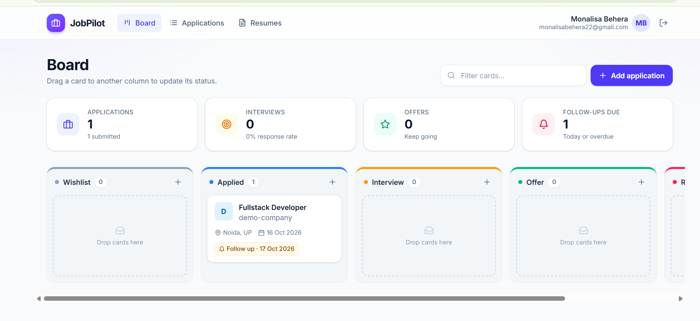
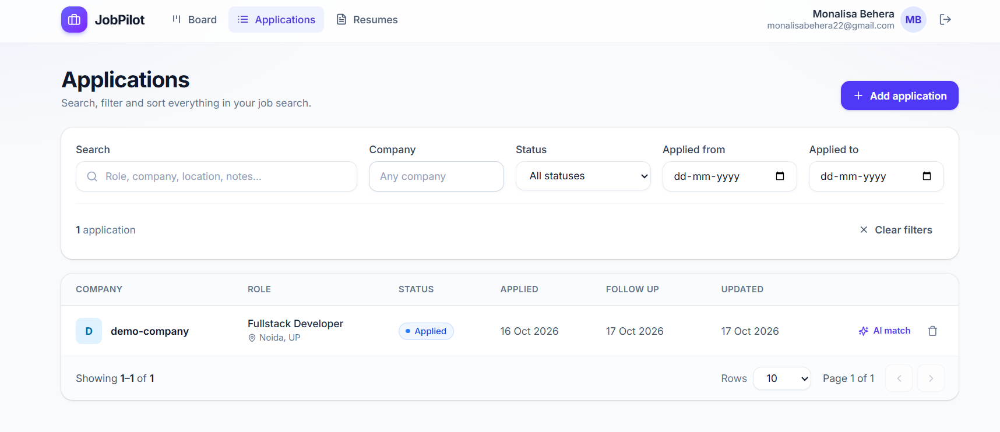
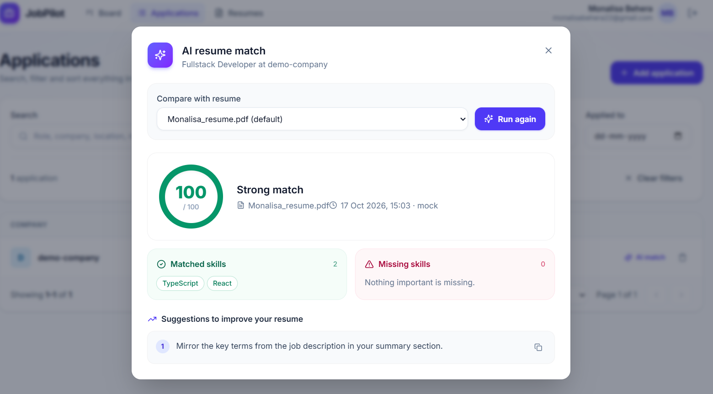
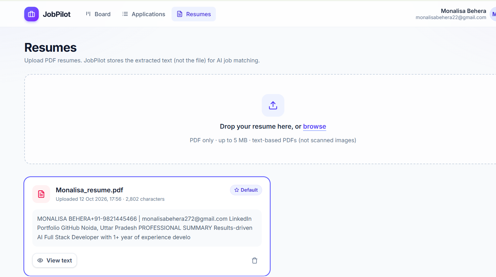
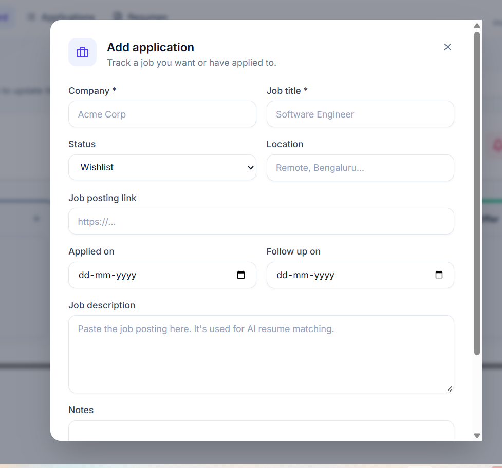
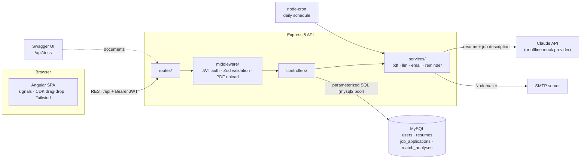
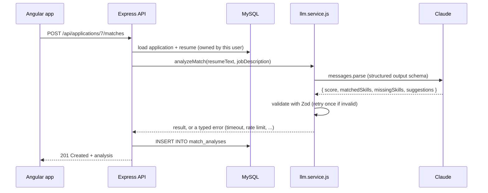

# JobPilot

**An AI-powered job application tracker.** Track every application on a drag-and-drop Kanban board, upload your resume as a PDF, and let Claude score how well it matches a job description — with the skills you're missing and tailored suggestions for your resume. A daily job emails you when it's time to follow up.


---

## Features

- **Secure accounts** — register and log in with bcrypt-hashed passwords and JWT authentication.
- **Kanban board** — drag cards between Wishlist → Applied → Interview → Offer → Rejected; the status saves instantly and rolls back if the server rejects it.
- **Searchable application list** — filter by status, company and applied-date range, search across title, company, location and notes, sort by any column, and paginate.
- **Resume management** — upload PDF resumes (5 MB max); text is extracted with `pdf-parse` and stored, the PDF itself is not. One resume is always your default.
- **AI match analysis** — Claude compares a resume with a job description and returns a 0–100 score, matched skills, missing skills and concrete resume suggestions, validated against a strict schema and saved to your history.
- **Follow-up reminders** — a `node-cron` job emails each user a daily summary of applications whose follow-up date has arrived (via Nodemailer).
- **Interactive API docs** — Swagger UI at `/api/docs`.
- **Tested** — 122 Jest + supertest tests against a real MySQL test database, ~98% line coverage.

## Screenshots

| Kanban board | Application list |
|---|---|
|  |  |

| AI resume match | Resumes |
|---|---|
|  |  |

| Add application |
|---|
|  |

## Tech stack

| Layer | Technology |
|---|---|
| Frontend | Angular 22 (standalone components, signals, zoneless), Angular CDK (drag-and-drop, dialogs), Tailwind CSS 4 |
| Backend | Node.js 20+, Express 5, ES modules, Zod validation, JWT (`jsonwebtoken`), `bcryptjs`, Multer, Helmet |
| Database | MySQL 8 (or MariaDB) via `mysql2/promise` with raw parameterized SQL — no ORM |
| AI | Anthropic Claude (`@anthropic-ai/sdk`, structured outputs) behind a swappable provider boundary |
| Jobs & email | `node-cron`, Nodemailer |
| Docs & tests | `swagger-jsdoc`, `swagger-ui-express`, Jest, supertest |

## Architecture



Every protected request follows the same path: **route → auth + validation middleware → controller → parameterized SQL**, and every query is scoped to the logged-in user's id, so one user can never read or change another user's data (requests for someone else's records return `404`).

**How an AI match works**



### Project structure

```
jobpilot/
├── jobpilot-api/                 # REST API
│   ├── db/schema.sql             # database schema
│   ├── scripts/                  # db:migrate, reminders:run
│   ├── src/
│   │   ├── app.js                # Express app (routes, docs, error handling)
│   │   ├── server.js             # startup: config checks, DB check, reminder job
│   │   ├── config/db.js          # shared MySQL pool
│   │   ├── routes/               # endpoints + OpenAPI comments
│   │   ├── middleware/           # auth, validation, upload, errors
│   │   ├── validators/           # Zod request schemas
│   │   ├── controllers/          # request handlers + SQL
│   │   ├── services/             # pdf, llm, email, reminder
│   │   └── docs/swagger.js       # OpenAPI definition
│   └── tests/                    # Jest + supertest
└── jobpilot-web/                 # Angular frontend
    ├── proxy.conf.json           # forwards /api to the API in development
    └── src/app/
        ├── core/                 # API services, auth, models
        ├── shared/               # dialogs, toasts, pipes
        └── features/             # auth, board, applications, resumes
```

## Getting started

### Prerequisites

- **Node.js 20+** and npm
- **MySQL 8** (or MariaDB, e.g. via XAMPP)
- Optional: an **Anthropic API key** for real AI analysis (a free offline mock is included)

### 1. Get the code

```bash
git clone <your-repo-url> jobpilot
cd jobpilot
```

### 2. Create the database

Run `jobpilot-api/db/schema.sql` in MySQL Workbench, phpMyAdmin, or the command line:

```bash
mysql -u root -p < jobpilot-api/db/schema.sql
```

> Upgrading an existing database from an earlier version? Run `npm run db:migrate` in `jobpilot-api` after step 3.

### 3. Configure and start the API

```bash
cd jobpilot-api
npm install
cp .env.example .env        # Windows: copy .env.example .env
```

Edit `.env` — at minimum set your database credentials and a `JWT_SECRET` of at least 32 random characters:

```bash
node -e "console.log(require('crypto').randomBytes(32).toString('base64'))"
```

Then start it:

```bash
npm run dev
```

You should see `Connected to MySQL` and `JobPilot API running on http://localhost:5000`. API docs: **http://localhost:5000/api/docs**

### 4. Start the frontend

In a second terminal:

```bash
cd jobpilot-web
npm install
npm start
```

Open **http://localhost:4200**, create an account, and start tracking.

## Configuration

All settings live in `jobpilot-api/.env` (see `.env.example`). Never commit your real `.env`.

| Variable | Default | Description |
|---|---|---|
| `PORT` | `5000` | API port |
| `CLIENT_URL` | `http://localhost:4200` | Frontend URL (CORS and links in emails) |
| `DB_HOST`, `DB_PORT`, `DB_USER`, `DB_PASSWORD`, `DB_NAME` | — | MySQL connection |
| `JWT_SECRET` | — | **Required**, 32+ characters |
| `JWT_EXPIRES_IN` | `1h` | Token lifetime |
| `TEST_DB_NAME` | `jobpilot_test` | Database that `npm test` drops and recreates |
| `LLM_PROVIDER` | `anthropic` | `anthropic` (Claude) or `mock` (offline keyword matching) |
| `ANTHROPIC_API_KEY` | — | Required when `LLM_PROVIDER=anthropic` |
| `LLM_MODEL` | `claude-opus-5-5` | Claude model |
| `LLM_TIMEOUT_MS` | `90000` | Total time budget per analysis, including retries |
| `LLM_MAX_RETRIES` | `2` | SDK retries for rate limits, overloads and network errors |
| `REMINDERS_ENABLED` | `true` | Turn the daily reminder job on or off |
| `REMINDER_CRON` | `0 8 * * *` | When reminders run (cron syntax; default 08:00 daily) |
| `REMINDER_TIMEZONE` | server zone | IANA time zone, e.g. `Asia/Kolkata` |
| `MAIL_TRANSPORT` | `log` | `log` prints emails to the console; `smtp` sends them |
| `MAIL_FROM` | `JobPilot <no-reply@jobpilot.local>` | Sender address |
| `SMTP_HOST`, `SMTP_PORT`, `SMTP_SECURE`, `SMTP_USER`, `SMTP_PASS` | — | SMTP settings when `MAIL_TRANSPORT=smtp` |

## API reference

Base URL: `http://localhost:5000/api`. Every endpoint except register and login needs `Authorization: Bearer <token>`. Full request and response schemas: **[/api/docs](http://localhost:5000/api/docs)** (raw spec at `/api/docs.json`).

| Method | Endpoint | Description |
|---|---|---|
| `POST` | `/auth/register` | Create an account → token + user |
| `POST` | `/auth/login` | Log in → token + user |
| `GET` | `/auth/me` | Current user |
| `GET` | `/applications` | List with `page`, `limit`, `status`, `company`, `search`, `dateFrom`, `dateTo`, `sortBy`, `sortOrder` |
| `POST` | `/applications` | Create (`companyName`, `jobTitle` required; status defaults to Wishlist) |
| `GET` | `/applications/:id` | Get one |
| `PUT` | `/applications/:id` | Update the fields you send (`null` clears a field) |
| `PATCH` | `/applications/:id/status` | Change only the status (Kanban board) |
| `DELETE` | `/applications/:id` | Delete |
| `POST` | `/applications/:id/matches` | Run an AI match (optional `resumeId`, defaults to your default resume) |
| `GET` | `/applications/:id/matches` | Saved analyses, newest first |
| `POST` | `/resumes` | Upload a PDF (`multipart/form-data`, field `resume`, max 5 MB) |
| `GET` | `/resumes` | List resumes (default first) |
| `GET` | `/resumes/:id` | One resume with its extracted text |
| `PATCH` | `/resumes/:id/default` | Make a resume your default |
| `DELETE` | `/resumes/:id` | Delete (the newest remaining resume becomes default) |

Errors are JSON: `{ "message": "..." }`. Validation errors add field details:

```json
{ "message": "Validation failed", "errors": [{ "field": "companyName", "message": "Company name is required" }] }
```

## AI match analysis

`src/services/llm.service.js` is the only place that talks to an AI provider, selected with `LLM_PROVIDER`:

- **`anthropic`** — Claude Opus 5.5 with structured outputs, so the reply must match the `{ score, matchedSkills, missingSkills, suggestions }` schema. The resume and job description are sent as clearly delimited data, so text inside them can't act as instructions. Server-side refusal fallback is enabled. A typical analysis costs a few US cents.
- **`mock`** — offline keyword matching for demos and tests. No API key, no cost.

Every result is validated again with Zod before it's saved. Failures are turned into clear responses, and nothing is saved when the AI fails:

| Situation | Response |
|---|---|
| Invalid or truncated AI output | One automatic retry, then `502` |
| Took longer than `LLM_TIMEOUT_MS` | `504` |
| AI service rate limit | SDK retries with backoff, then `429` + `Retry-After` |
| AI service overloaded or unreachable | `503` |
| No or invalid API key | `503` (plus a startup warning) |
| AI declined the request | `422` |
| A second analysis while one is running | `429` |

## Follow-up reminders

A `node-cron` job (default: every day at 08:00) finds open applications — not Offer or Rejected — whose `nextFollowUpOn` date has arrived, and sends each user **one** email listing only their own applications. Each application is reminded once per follow-up date; setting a new date re-arms it. If an email fails, that user is retried on the next run.

**Try it now** without waiting for the schedule:

```bash
cd jobpilot-api
npm run reminders:run
```

With the default `MAIL_TRANSPORT=log`, emails are printed in the terminal. To send real email, set `MAIL_TRANSPORT=smtp` and your SMTP settings — for Gmail, use `SMTP_HOST=smtp.gmail.com`, `SMTP_PORT=587`, your address as `SMTP_USER`, and a [Google app password](https://support.google.com/accounts/answer/185833) as `SMTP_PASS`.

## Testing

```bash
cd jobpilot-api
npm test                 # all tests
npm run test:coverage    # with a coverage report
```

Tests run against a separate database (`TEST_DB_NAME`, default `jobpilot_test`) that is **dropped and recreated from `db/schema.sql` on every run** — your development data is never touched (the run refuses to start if the test database name equals `DB_NAME`). MySQL must be running. Tests always use the mock AI provider and a fake email transport, so they never call Claude or send email.

| Suite | Covers |
|---|---|
| `auth.test.js` | Register, login, `/me`, duplicate emails, expired/forged/unsigned tokens |
| `applications.test.js` | CRUD, pagination, every filter, search, sorting, status PATCH, cross-user isolation |
| `resumes.test.js` | PDF upload rules (type, size, scanned, corrupt), default handling, cross-user isolation |
| `matches.test.js` | Match endpoint, ownership checks, every AI error → HTTP status, one-at-a-time limit |
| `llm.service.test.js` | Real Anthropic SDK against a local fake server: invalid JSON, schema violations, refusals, 429, 529, 401, timeouts |
| `reminders.test.js` | Due-date logic, per-user emails, no duplicates, retry after failure, HTML escaping |
| `email-scheduler.test.js` | Email transports and scheduler configuration |
| `docs.test.js` | Every route is documented, no broken references, Swagger UI loads |

## Security notes

- Passwords hashed with bcrypt (cost 12); login errors don't reveal whether an email exists.
- JWTs are pinned to HS256 with issuer and audience checks.
- All SQL is parameterized; sort columns come from a fixed allowlist.
- Every query is scoped to the authenticated user.
- Uploads are checked by file signature, not just MIME type, and never written to disk.
- Helmet security headers, CORS restricted to the frontend, 1 MB JSON body limit.
- User-entered text is HTML-escaped in reminder emails.
